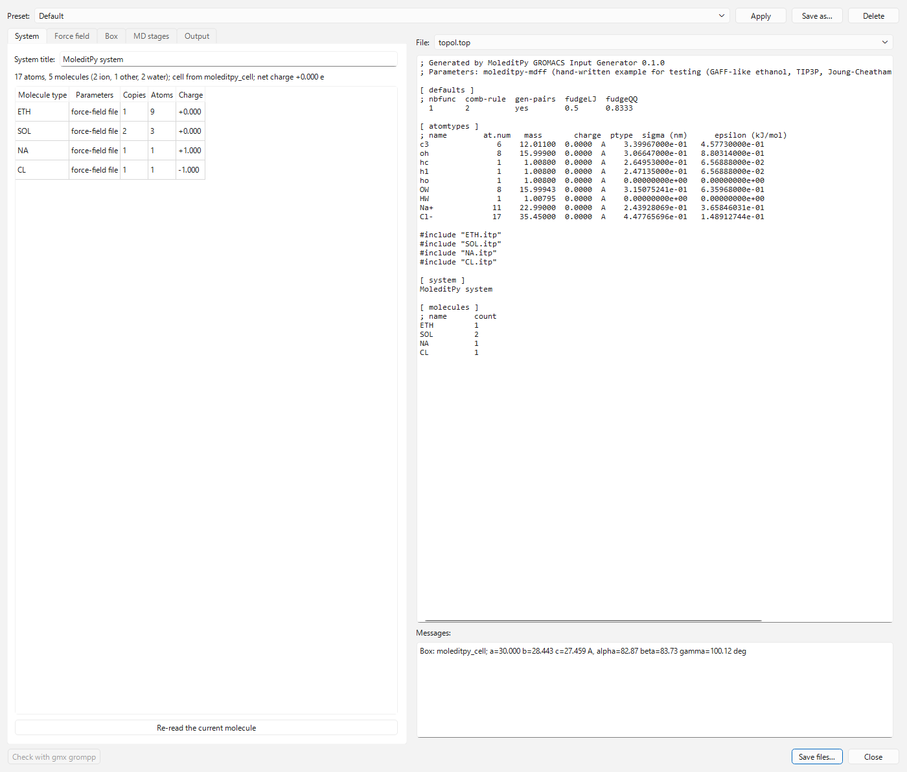
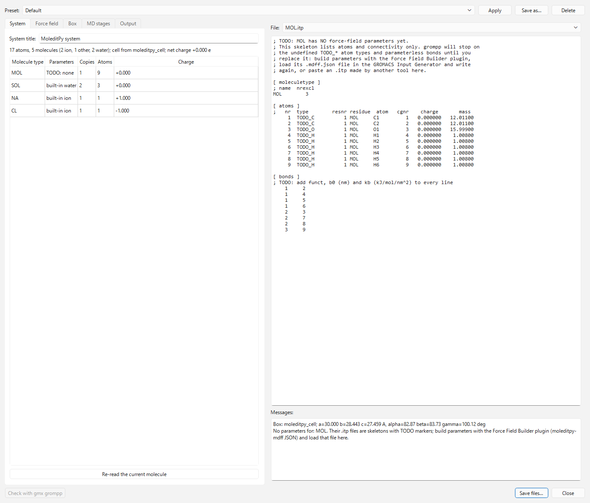
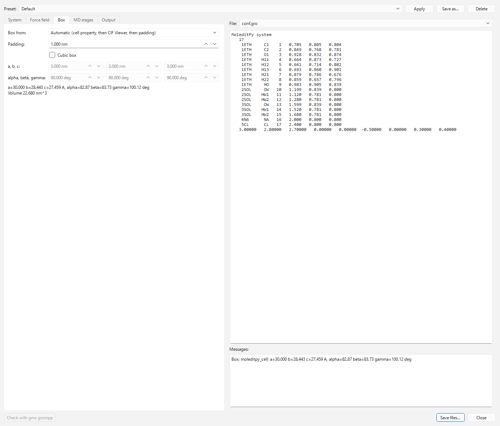
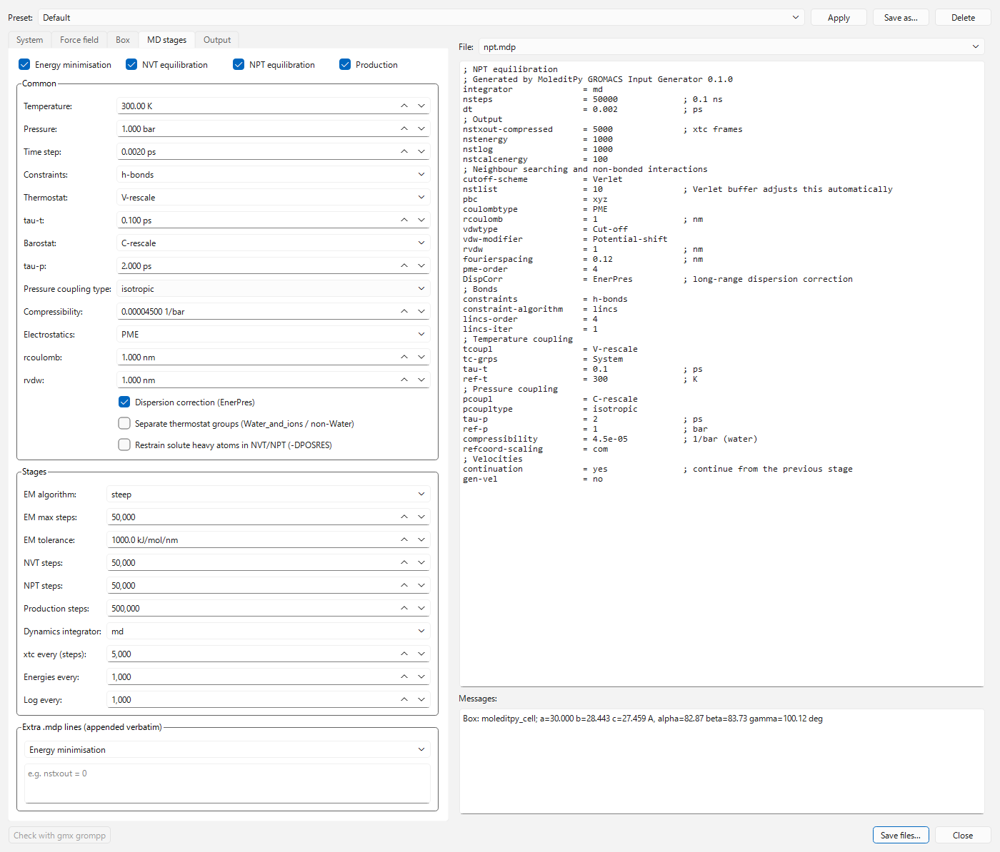

# GROMACS Input Generator (MoleditPy plugin)

[](https://github.com/HiroYokoyama/python_molecular_editor)

Writes a ready-to-run GROMACS input set from the molecule or MD system open in
[MoleditPy](https://github.com/HiroYokoyama/python_molecular_editor):

- `conf.gro` with the box from the molecule's `moleditpy_cell` (triclinic cells
  included), the CIF Viewer cell, a padded bounding box, or explicit lengths and angles
- `topol.top` plus one `.itp` per molecule type, from a `moleditpy-mdff` force-field
  file (written by the Force Field Builder plugin) or from built-in tables
- `em.mdp`, `nvt.mdp`, `npt.mdp`, `md.mdp` with editable parameters and presets
- `index.ndx` (System / Protein / Water / Ion / Water_and_ions / Other / non-Water)
- `run.sh` and `run.bat` chaining `gmx grompp` and `gmx mdrun` through the stages

Open it from **File > Export > GROMACS Input (.gro/.top/.mdp)...**. Every file is
previewed live while you change options; **Save files...** writes them to a folder.



## Topology

Molecules are found from the bonds (or from distances when the molecule has no
bonds). Identical molecules (same elements in the same order, same bonds, residue
names and formal charges) share one `[ moleculetype ]`, and consecutive copies are
counted in one `[ molecules ]` line. GROMACS needs each molecule's atoms to be
contiguous, so atoms are reordered when a molecule's atoms are scattered through the
host's atom list; the dialog says so and `conf.gro`/`index.ndx` follow the new order.

Parameters come from, in this order:

1. **A `moleditpy-mdff` file** (`*.mdff.json`, format version 1), the force-field
   hand-off format shared by the MoleditPy MD plugins. Its `system` list maps molecule
   types onto the host atoms; the plugin checks the elements match. Harmonic bonds and
   angles, periodic proper (funct 9) and improper (funct 4) torsions, 1-4 pairs
   generated from the bond graph (`gen-pairs yes` with the file's fudge factors),
   constraints and SETTLE water are written. Combination rules 1, 2 and 3 are
   supported.
2. **Built-in tables** for what the file does not cover: TIP3P or SPC/E water (rigid,
   SETTLE; `-DFLEXIBLE` switches to harmonic bonds) and monatomic ions Li, Na, K, Rb,
   Cs, F, Cl, Br, I (Joung-Cheatham) and Mg, Ca, Sr, Ba, Zn (Li-Merz 12-6), each set
   matched to the chosen water model. Values are those of the Amber ion/water files
   distributed with OpenMM (`amber14/tip3p.xml`, `amber14/spce.xml`).
3. **A skeleton** for everything else: an `.itp` with the atoms, connectivity and clear
   `TODO` markers. `grompp` stops on it on purpose until the molecule is parameterised;
   use the Force Field Builder plugin and load its `.mdff.json` here.



Example force-field files (hand-written test data, not validated parameter sets) are in
[`examples/`](examples/).

## Box

The suite's cell convention is the RDKit molecule property `moleditpy_cell`, a JSON
string `{"lattice": [[ax,ay,az],[bx,by,bz],[cx,cy,cz]], "origin": [x,y,z], "pbc":
[true,true,true]}` in Angstrom. Any right-handed cell is rotated into the GROMACS
setting (a along x, b in the xy plane) together with the coordinates, and reduced so
that |b_x|, |c_x| <= a_x/2 and |c_y| <= b_y/2. A cut-off longer than half the
smallest box width is reported before `grompp` sees it.

MoleditPy's undo snapshots and project files store the molecule with RDKit's
`ToBinary()`, which drops molecule properties, so `moleditpy_cell` is lost after an
undo or a save and reopen. The plugin keeps the last cell it saw, stores it in the
project and puts it back on the molecule after loading when the atom count matches.



## MD stages

Energy minimisation (steep / cg / l-bfgs), NVT (velocities generated), NPT and
production (continuing from the previous checkpoint). Temperature, pressure, time
step, constraints, thermostat (V-rescale, Nose-Hoover, Berendsen or the sd
integrator), barostat (C-rescale, Parrinello-Rahman, Berendsen; NPT equilibration
always uses C-rescale), coupling type, PME / reaction field, cut-offs, output
frequencies, separate thermostat groups and position restraints are editable, and
any extra `.mdp` lines can be appended per stage. Presets are kept in `settings.json`
beside the plugin.



If `gmx` (or `gmx_mpi`) is on `PATH`, **Check with gmx grompp** runs `grompp` on the
first stage in a temporary folder and shows its output.

## Requirements

Nothing beyond MoleditPy 5 itself (numpy, RDKit, PySide6). GROMACS is needed only to
run the generated files.

## Development

```bash
git submodule update --init
python scripts/materialize_shared.py   # copies the shared periodic-cell modules in
python -m pytest tests/ -v
```

`cell_model.py`, `elements.py`, `cell_preview.py` and `structure_panel.py` come from
[moleditpy-periodic-shared](https://github.com/HiroYokoyama/moleditpy-periodic-shared)
and are not committed here.

## License

LGPL-3.0-or-later. See [LICENSE](LICENSE), [COPYING](COPYING) and
[LICENSING.md](LICENSING.md).
